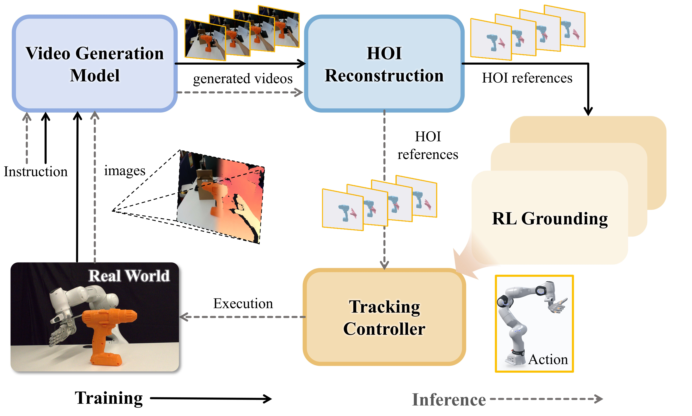

<h1 align="center">GALATEA: Grounding Generated Video Plans in Simulation Towards Versatile Dexterous Controllers</h1>

<p align="center">
  <a href="https://tianyueh8erobot.github.io/">Tianyue Wu</a><sup>2,3,1,*,‡</sup>,
  <a href="https://boyuan-an.github.io/">Boyuan An</a><sup>2,1,*</sup>,
  <a href="https://zhao-sq.github.io/">Shuqi Zhao</a><sup>1</sup>,
  <a href="https://github.com/GuoHeyu">Heyu Guo</a><sup>2</sup>,
  <a href="https://wlxing1901.github.io/">Wanli Xing</a><sup>2</sup>,
  <br>
  <a href="https://people.eecs.berkeley.edu/~yima/">Yi Ma</a><sup>3,1</sup>,
  <a href="https://openreview.net/profile?id=%7EKaifeng_Zhang1">Kaifeng Zhang</a><sup>2</sup>,
  <a href="https://warshallrho.github.io/">Ruihai Wu</a><sup>1,†</sup>,
  <a href="https://me.berkeley.edu/people/masayoshi-tomizuka/">Masayoshi Tomizuka</a><sup>1,†</sup>
</p>

<p align="center">
  <sup>1</sup>UC Berkeley &nbsp;&nbsp; <sup>2</sup>Sharpa &nbsp;&nbsp; <sup>3</sup>The University of Hong Kong
  <br>
  <sup>*</sup>Equal contribution &nbsp;&nbsp; <sup>†</sup>Co-advisors &nbsp;&nbsp; <sup>‡</sup>Corresponding author
</p>

<h3 align="center">
  <a href="https://boyuan-an.github.io/GALATEA/resources/GALATEA_paper.pdf">📄 Paper</a> |
  <a href="https://boyuan-an.github.io/GALATEA/">🌐 Project Page</a>
</h3>

> [!NOTE]
> This public code was obtained by reorganizing our development code with vibe coding.
> If you run into any problems, please [open an issue](https://github.com/boyuan-an/GALATEA/issues).

<p align="center">
  
</p>

## TL;DR

Video generation as reference data to train RL dexterous controller when training, and as motion planner executed by the tracker when deploying.

## Abstract

Generated hand–object interaction videos provide a controllable way to propose manipulation motions. **GALATEA** combines generated videos with simulation-based HOI grounding: generated videos provide diverse motion references for learning a multi-object, multi-trajectory HOI tracker, while at deployment time video models produce motion plans that are executed by the learned tracker. With minimal manual intervention, the reconstruction pipeline yields approximately 2,000 usable references from 2,500 generated clips, of which more than 1,500 trajectories are grounded in simulation. In closed-loop real-world experiments, the distilled controller performs functional grasps, non-prehensile manipulation, and post-grasp object-pose tracking.

---

## 📋 TODO

We will publicly release the remaining item below **before November 2026**.

- [x] Release the [HOI reconstruction code](recon/README.md) and [example generated videos](recon/examples/power_drill/README.md).
- [x] Release the [reinforcement-learning tracking code](rl/README.md) and pretrained checkpoints.
- [x] Release the [example datasets](rl/README.md#data-and-checkpoints) for reinforcement-learning tracking.

## Repository structure

| Directory | Contents | Status |
|---|---|---|
| [`recon/`](recon/README.md) | HOI reconstruction: from a generated video and an object mesh to hand–object trajectories, with installation, the bundled example, and baseline adapters | Released |
| [`rl/`](rl/README.md) | Reinforcement-learning tracking: data preprocessing, training and evaluation of the arm–hand tracking policy, with pretrained checkpoints and datasets | Released |

Each component has its own environments and documentation. To run the bundled
reconstruction example:

```bash
git clone https://github.com/boyuan-an/GALATEA.git
cd GALATEA/recon
bash scripts/setup/install.sh
```

Then obtain the model files described in
[recon/docs/model-assets.md](recon/docs/model-assets.md) and run:

```bash
bash scripts/setup/check_install.sh --gpu
bash scripts/run_example.sh --gpu 0
```

See the [reconstruction README](recon/README.md) for inputs, outputs, and options,
and the [tracking README](rl/README.md) for data preprocessing and for training
and evaluating the tracking policy.

## Citation

If you use this code in your research, please cite GALATEA:

```bibtex
@article{wu2026galatea,
  title   = {Grounding Generated Video Plans in Simulation Towards Versatile Dexterous Controllers},
  author  = {Wu, Tianyue and An, Boyuan and Zhao, Shuqi and Guo, Heyu and Xing, Wanli and Ma, Yi and Zhang, Kaifeng and Wu, Ruihai and Tomizuka, Masayoshi},
  journal = {arXiv preprint arXiv:2609.10050},
  year    = {2026},
  url     = {https://arxiv.org/abs/2609.10050}
}
```

## Acknowledgments

Parts of the reconstruction code build on the code framework of [GRAIL](https://github.com/NVlabs/GRAIL).
The reconstruction pipeline integrates MoGe-2, GroundingDINO, SAM 2,
FoundationPose, WiLoR, and HOI-DETR. We thank the authors of these projects for
making their work available. Please also cite the works relevant to your use;
component links are collected in [recon/THIRD_PARTY.md](recon/THIRD_PARTY.md).
The tracking code builds on ManipTrans, SimToolReal, SAPG, rl_games, and Isaac
Gym Envs; see [rl/THIRD_PARTY.md](rl/THIRD_PARTY.md).

## License

This repository is released under the [NVIDIA License](LICENSE), which limits
use to non-commercial research and evaluation, except for `rl/`. The tracking
component in `rl/` is modified from GPL-3.0 code and is released under the GNU
General Public License v3.0 ([rl/LICENSE](rl/LICENSE)). Third-party code,
checkpoints, and MANO data retain their own terms; see
[recon/THIRD_PARTY.md](recon/THIRD_PARTY.md) and [rl/THIRD_PARTY.md](rl/THIRD_PARTY.md).
